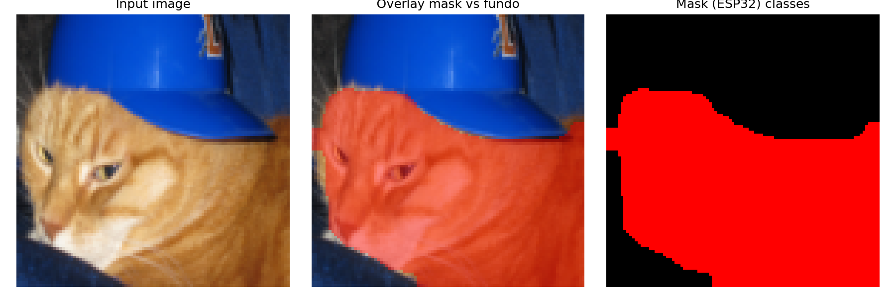
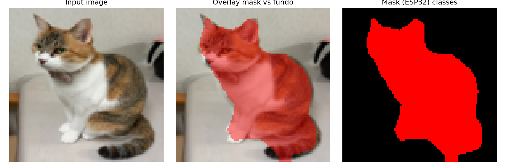
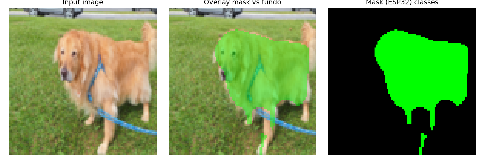
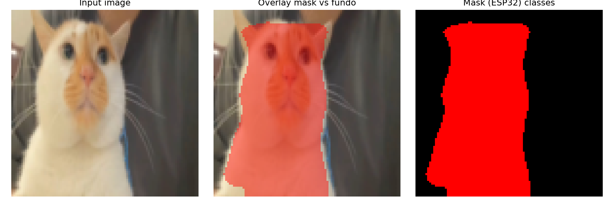
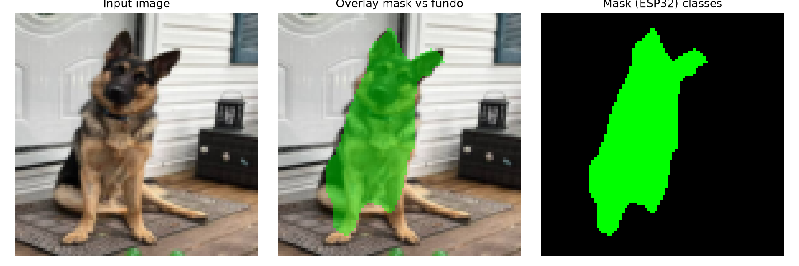
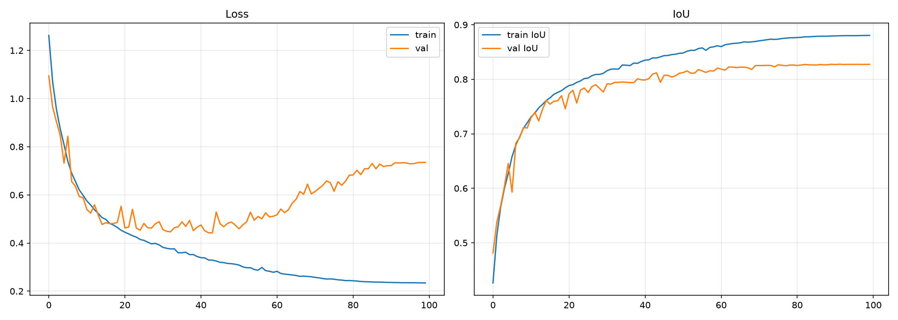

# Cat and Dog Segmentation on ESP32-S3

[Português (Brasil)](README.pt-BR.md) · [Quickstart](docs/QUICKSTART.md) · [HTTP API](docs/HTTP_API.md) · [Model card](docs/MODEL_CARD.md)

Fast-SCNN runs on the ESP32-S3 and classifies each pixel of a 96 × 96 RGB image as background, cat, or dog. The firmware loads a **1.53 MB INT8 model** from LittleFS and serves binary masks or raw logits over Wi-Fi.

## Segmentation results

Each ESP32-S3 example shows the input image, the mask overlaid on the image, and the predicted class mask. Red marks cats, green marks dogs, and black marks background.

| TFLite export | Test-set multiclass IoU |
| --- | ---: |
| FP32 | 0.8347 |
| **Full INT8** | **0.8207** |

These scores come from the original host evaluation. A historical reference build matched the host bit for bit on all 61 operators for one test image. Hardware parity for the current **TFLite Micro 1.3.8 + ESP-NN 1.3.0** build is pending. [Evaluation details](docs/MODEL_CARD.md) · [Validation procedure](docs/TFLM_DEBUG_PLAYBOOK.md)

Training and validation curves

## Run on the ESP32-S3

The firmware targets an ESP32-S3 DevKitC-1 N16R8, with 16 MB flash and 8 MB PSRAM. Initialize the submodules, apply the local patches, set your Wi-Fi credentials, then build and upload the firmware and the LittleFS image with PlatformIO. The Python client sends a sample image and saves a segmentation plot. [Step-by-step quickstart](docs/QUICKSTART.md)

## Repository guide

| Directory | Contents |
| --- | --- |
| [firmware](firmware/) | ESP-IDF application, LittleFS model and Python clients |
| [training](training/) | Architecture, training notebook, exported models and evaluation plots |
| [components](components/) | Pinned Espressif submodules and local patches |
| [docs](docs/) | Setup, API, model card, porting and debugging guides |

The architecture follows Fast-SCNN by Poudel, Liwicki and Cipolla. [Fast-SCNN paper](https://arxiv.org/abs/1902.04502)
