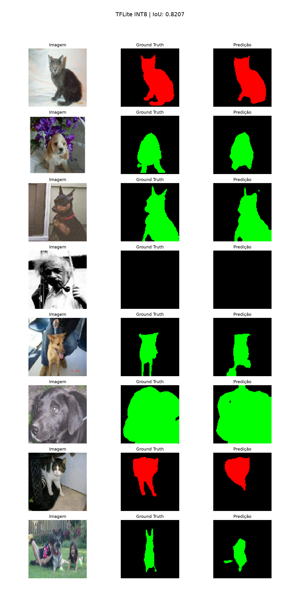
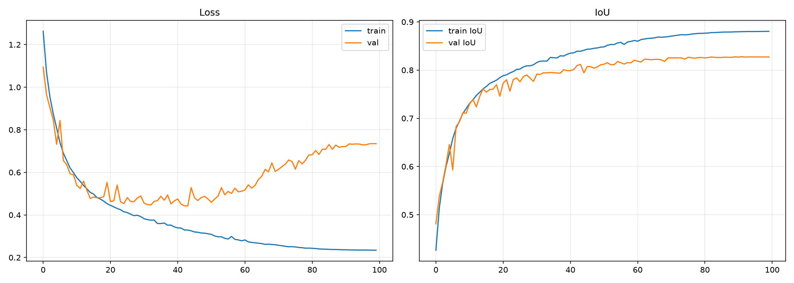

# Segmentação de gatos e cachorros no ESP32-S3

[English](README.md) · [Guia de instalação](docs/QUICKSTART.md) · [API HTTP](docs/HTTP_API.md) · [Ficha do modelo](docs/MODEL_CARD.md)

O Fast-SCNN roda no ESP32-S3 e classifica cada pixel de uma imagem RGB de 96 × 96 como fundo, gato ou cachorro. O firmware carrega um **modelo INT8 de 1,53 MB** do LittleFS e retorna máscaras binárias ou logits brutos por Wi-Fi.

## Resultados de segmentação

  

*Da esquerda para a direita, imagem de entrada, máscara anotada e previsão INT8. Vermelho indica gato, verde indica cachorro e preto indica fundo.*

| Exportação TFLite | IoU multiclasse no conjunto de teste |
| --- | ---: |
| FP32 | 0,8347 |
| **INT8 completo** | **0,8207** |

As métricas vêm da avaliação original no computador. Um build de referência anterior apresentou igualdade bit a bit com o computador nos 61 operadores para uma imagem de teste. A validação em hardware do build atual com **TFLite Micro 1.3.8 + ESP-NN 1.3.0** está pendente. [Detalhes da avaliação](docs/MODEL_CARD.md) · [Procedimento de validação](docs/TFLM_DEBUG_PLAYBOOK.md)

Curvas de treino e validação

## Como rodar no ESP32-S3

O firmware usa um ESP32-S3 DevKitC-1 N16R8, com 16 MB de flash e 8 MB de PSRAM. Inicialize os submódulos, aplique os patches locais, configure o Wi-Fi e grave o firmware e a imagem LittleFS via PlatformIO. O cliente Python envia uma imagem de exemplo e salva uma visualização da segmentação. [Passo a passo em inglês](docs/QUICKSTART.md)

## Estrutura do repositório

| Diretório | Conteúdo |
| --- | --- |
| [firmware](firmware/) | Aplicação ESP-IDF, modelo LittleFS e clientes Python |
| [training](training/) | Arquitetura, notebook de treino, modelos e gráficos da avaliação |
| [components](components/) | Submódulos da Espressif com versões fixadas e patches locais |
| [docs](docs/) | Instalação, API, ficha do modelo e guias de porte e depuração |

A arquitetura segue o Fast-SCNN de Poudel, Liwicki e Cipolla. [Artigo do Fast-SCNN](https://arxiv.org/abs/1902.04502)
